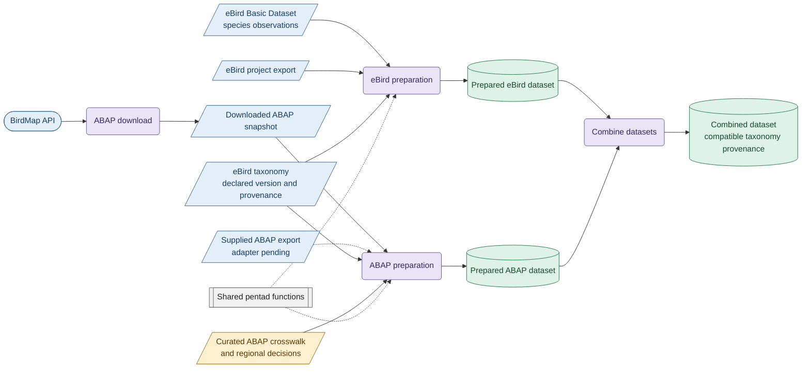

# Bird Atlas data workflows

Prepare ABAP and eBird observations as versioned, linked datasets for research. The workflows preserve source provenance, use an explicitly selected eBird taxonomy, and distinguish original ABAP cards from eBird-derived candidates.

This repository supersedes [eBird2ABAP](https://github.com/Rafnuss/eBird2ABAP): its eBird-to-card conversion now lives in `bird_atlas/ebird2card.py`. eBird2ABAP is archived and its releases remain installable.



Blue represents source data, orange curated decisions, purple processing, gray shared code, and green prepared datasets. A dashed connection marks a shared utility or a planned input adapter. EBD sampling metadata are separate from the species observations consumed by the current converter.

## Get started

```sh
uv sync
uv run python scripts/ebird/prepare.py --input /path/to/observations.txt.gz --taxonomy data/taxonomy/ebird_2025.csv --ebird-version 2025 --source-kind ebd --cache data/cache/ebd/africa.duckdb --output /path/to/prepared-ebird
uv run python scripts/abap/prepare.py --snapshot /path/to/completed-snapshot --taxonomy data/taxonomy/ebird_2026.csv --output-dir /path/to/prepared-abap
uv run python scripts/shared/validate.py /path/to/prepared-ebird
```

Choose a new output directory for each run and supply the relevant local source files and eBird reference. The [eBird preparation guide](docs/ebird-preparation.md), [ABAP preparation guide](docs/abap-to-ebird.md), and [data-package reference](docs/data-package.md) explain the workflows and outputs.

Full EBD preparation uses a reusable trimmed disk cache and processes complete observer histories in batches; observation-scale tables stay out of pandas. The [performance notes](docs/ebird-performance.md) document a complete Africa run and laptop tuning.

## Project structure

The [spatial-grid reference](docs/spatial-grids.md) explains pentad naming, the extended QDGC hierarchy, and the 30-minute Kenya Bird Trends squares, with conversion and aggregation examples.

| Path | Purpose |
| --- | --- |
| [`bird_atlas/`](bird_atlas/) | Shared functions for pentads, checklist effort, eBird full and ad-hoc cards, and data packages |
| [`scripts/abap/`](scripts/abap/) | Download BirdMap data and prepare ABAP datasets |
| [`scripts/ebird/`](scripts/ebird/) | Download EBD releases and prepare EBD or project exports |
| [`scripts/shared/`](scripts/shared/) | Combine or validate datasets, audit pentad naming, and export the latest record per QDGC square and species for Kenya Bird Trends ([guide](docs/kenyabirdtrend-pipeline.md)) |
| `data/raw/` | Locally supplied or downloaded source data; ignored by Git |
| `data/taxonomy/` | Curated ABAP mappings and local eBird reference files |
| `data/curated/observer_crosswalk.csv` | Curated observer IDs and display names, with lookup provenance |
| `data/curated/abap_kenya_flagged_spp.csv` | KBM `Spp` codes not expected in Kenya; excluded from the Kenya Bird Trends output and listed for the KBM vetting team |
| `data/prepared/` | Generated source-specific and combined datasets; ignored by Git |
| [`notebook/`](notebook/) | [ABAP](notebook/01_abap_pipeline.ipynb) and [eBird](notebook/02_ebird_pipeline.ipynb) walkthroughs |
| [`docs/`](docs/) | Preparation guides and the shared data-package reference |
| [`tests/`](tests/) | Synthetic conversion and scientific regression checks |

The observer crosswalk retains the source checklist, lookup status and lookup timestamp for each entry. It is maintained separately: the preparation pipelines do not apply it, but `scripts/shared/resolve_observers.py` updates it and `scripts/shared/latest_by_qdgc.py` uses it to name observers in the Kenya Bird Trends export.

Prepared source datasets mirror their input folders: for example, `data/raw/ebird/ebd_AFR_relSep-2026/` corresponds to `data/prepared/ebird/ebd_AFR_relSep-2026/`, and ABAP downloads use `abap/downloaded/` in both. Choose a distinct output path when keeping multiple preparations of one input; provenance is recorded in each package manifest.

Notebook inputs under `data/raw/` are local and must be supplied separately in a fresh checkout. The ABAP example uses a completed Kenya snapshot; the eBird example's illustrative taxonomy version must be checked before research use.

```sh
uv run python -m unittest discover -s tests -v
uv run ruff check bird_atlas scripts tests --select E9,F
```
